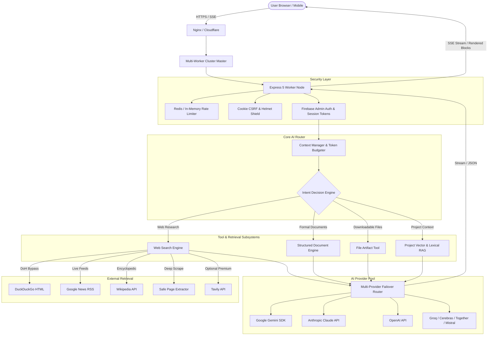
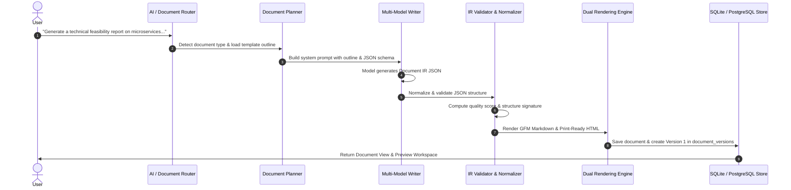

# Vixy AI — Unified Multi-Provider AI Workspace

[](https://nodejs.org/)
[](https://expressjs.com/)
[](https://firebase.google.com/)
[](LICENSE)
[](#multi-provider-ai-architecture)

> **Vixy AI** is an enterprise-grade, multi-provider AI workspace that unifies frontier language models, real-time grounded web search, structured document generation, interactive downloadable file artifacts, persistent project workspaces, and reusable markdown skills into a cohesive, high-performance interface.

---

## Table of Contents

- [Overview & Product Identity](#overview--product-identity)
- [System Architecture](#system-architecture)
- [Web Search Engine Deep Dive](#web-search-engine-deep-dive)
  - [Multi-Source Retrieval Pipeline](#multi-source-retrieval-pipeline)
  - [Intelligent Query Adaptation & Global News Search](#intelligent-query-adaptation--global-news-search)
  - [Machine-Verifiable Temporal Engine & Date Extraction](#machine-verifiable-temporal-engine--date-extraction)
  - [Publisher Attribution & Multi-Part Domain Normalization](#publisher-attribution--multi-part-domain-normalization)
  - [Live Web Scraping & Page Extraction](#live-web-scraping--page-extraction)
  - [How the AI Interacts with Web Search](#how-the-ai-interacts-with-web-search)
- [Document Engine & Artifact Generation Deep Dive](#document-engine--artifact-generation-deep-dive)
  - [Structured Document IR & 16 Enterprise Templates](#structured-document-ir--16-enterprise-templates)
  - [Multi-Stage Document Pipeline](#multi-stage-document-pipeline)
  - [Dual Rendering Engine: Markdown & Print-Ready HTML](#dual-rendering-engine-markdown--print-ready-html)
  - [Revision Engine & Multi-Version History](#revision-engine--multi-version-history)
  - [Interactive File Artifacts (`vixy-file`)](#interactive-file-artifacts-vixy-file)
  - [How the AI Utilizes the Document & Artifact Tools](#how-the-ai-utilizes-the-document--artifact-tools)
- [Core Workspace Capabilities](#core-workspace-capabilities)
  - [Multi-Provider Model Orchestration & Health Pool](#multi-provider-model-orchestration--health-pool)
  - [Project Workspaces & Context RAG](#project-workspaces--context-rag)
  - [Reusable Markdown Skills (`SKILL.md`)](#reusable-markdown-skills-skillmd)
  - [Memory Extraction & Long-Term Recall](#memory-extraction--long-term-recall)
- [Production Infrastructure & Security](#production-infrastructure--security)
- [Technology Stack](#technology-stack)
- [Installation & Setup](#installation--setup)
- [Configuration & Environment Variables](#configuration--environment-variables)
- [API Reference](#api-reference)
- [Evaluation & Testing](#evaluation--testing)

---

## Overview & Product Identity

Conventional AI interfaces treat the user session as a single chat prompt attached to a single model provider. **Vixy AI** is engineered as a unified workspace:

```text
VIXY AI WORKSPACE
  ├── Multi-Provider Model Orchestration (Gemini, OpenAI, Anthropic, Groq, Cerebras, Together, Mistral, OpenRouter)
  ├── Grounded Web Search Engine (Multi-Source, DoH Bypass, Date Verification, Publisher Normalization)
  ├── Structured Document Engine (Document IR, 16 Outlines, Validation, Print-Ready HTML & GFM)
  ├── AI File Artifact Generation (One-Click Downloads, Live Sandboxed Previews, Code Deduplication)
  ├── Project Workspaces (Multi-File Ingestion, Owner Isolation, Scoped RAG)
  ├── Reusable Markdown Skills System (SKILL.md Workflows)
  └── Enterprise Security & Infrastructure (Multi-Worker Cluster, Redis Cooldowns, CSRF, Daily UTC Caps)
```

New users immediately gain access to multi-provider capabilities, grounded research, verified citations, and runnable artifacts from a single responsive interface without juggling disparate tools or paying multiple isolated subscriptions.

---

## System Architecture



---

## Web Search Engine Deep Dive

Vixy's Web Search Engine is an integrated research system designed to provide verified, grounded, and up-to-the-minute information while preventing hallucinations. Rather than depending on a single opaque API, Vixy orchestrates a resilient multi-source pipeline.

### Multi-Source Retrieval Pipeline

1. **DuckDuckGo HTML Engine with DoH Bypass**:
   - Executes live searches via `html.duckduckgo.com` with strict Safe Search (`kp=1`).
   - Integrates a custom Node.js `https.Agent` utilizing **DNS-over-HTTPS (DoH)** with Cloudflare (`1.1.1.1`) and Google (`8.8.8.8`) upstream resolvers.
   - A background IP refresher periodically updates resolved addresses to eliminate DNS blocking, SNI tampering, or local ISP filtering with zero latency impact.
   - Automatically unescapes and cleans redirect wrappers (`//duckduckgo.com/l/?uddg=...`).

2. **Google News RSS Feed**:
   - Fetches live breaking news, chronological timestamps, and publisher tags directly from regional and global Google News feeds.
   - Automatically computes relative time deltas (`diffHours`, `diffMins`, `diffDays`) using `Intl.RelativeTimeFormat`.
   - Aggregates multi-source article clusters (`relatedCoverage`) into high-density context.

3. **Wikipedia Multilingual API**:
   - Queries regional Wikipedia endpoints (`id.wikipedia.org` or `en.wikipedia.org`) for encyclopedic definitions, historical context, and official release timelines via MediaWiki API extracts.

4. **First-Party Documentation Engine**:
   - Directly checks official product and model newsrooms (such as Anthropic Newsroom and OpenAI API documentation) for authoritative facts regarding model releases and technical specifications.

5. **Tavily Search API (Optional)**:
   - When `TAVILY_API_KEY` is provided, integrates premium search with news topics and configurable temporal freshness ranges.

---

### Intelligent Query Adaptation & Global News Search

Vixy dynamically adapts queries to bridge linguistic and regional divides:

- **Global News Expansion (`FOREIGN_REGION_RULES`)**:
  Identifies when a user query in Bahasa Indonesia, Malay, or another language targets foreign or global events across 30+ countries and regions (e.g., United States, Japan, UK, China, South Korea, Germany, France, Russia, Ukraine, Middle East, EU, etc.).
- **Dual-Language Retrieval**:
  When international news is requested in Indonesian (e.g., *"berita terbaru perang di timur tengah"*), the engine constructs a high-precision international English query (e.g., `"middle east conflict war news headlines today 2026"`) to retrieve authoritative primary sources while preserving the user's conversation language for the final response.
- **Temporal Token Deduplication**:
  Cleans repetitive keywords and deduplicates calendar years using `deduplicateQueryTokens`.

---

### Machine-Verifiable Temporal Engine & Date Extraction

AI search responses require verifiable recency. Vixy applies a four-tier date extraction engine across all search results:

1. **Relative Timestamp Parser**: Recognizes `"3 hours ago"`, `"2 jam yang lalu"`, `"kemarin"`, `"yesterday"`, and converts them to precise UTC ISO strings.
2. **ISO Timestamp Matcher**: Parses `YYYY-MM-DD` and `YYYY-MM-DDTHH:mm:ssZ` standards.
3. **Multilingual Calendar Date Parser**: Detects both day-first (`"17 Sep 2026"`, `"17 September 2026"`) and month-first (`"Sep 17, 2026"`) formats across English and Indonesian month names.
4. **URL Path Date Extractor (`extractPublishedDateFromUrl`)**: Extracts publication dates directly from URL path patterns (e.g., `/2026/09/17/article-slug` or `/2026-09-17-slug`) when snippets omit explicit timestamps.
5. **Freshness Cutoff Enforcement**: For queries categorized as `news_event`, records older than the dynamic cutoff window (defaulting to 3–7 days) are filtered out to prevent stale reporting.

---

### Publisher Attribution & Multi-Part Domain Normalization

To ensure sources never degrade into ambiguous `"Web"` placeholders or raw subdomain prefixes:

- **Multi-Part Public Suffix Resolution (`derivePublisherNameFromDomain`)**:
  Accurately identifies registrants across complex ccTLDs, including `.co.id`, `.go.id`, `.ac.id`, `.gov.uk`, `.ac.uk`, `.edu.au`, `.co.jp`, etc.
  - `portal.komdigi.go.id` → **Komdigi**
  - `pgsd.fip.unesa.ac.id` → **Unesa**
  - `jakarta.telkomuniversity.ac.id` → **Telkom University**
  - `analysis.netray.id` → **Netray**
- **Brand Mapping**:
  Maintains clean title casing for major global and national publishers (BBC, CNN, GitHub, The New York Times, Kompas, Detik, Tempo, Antara, etc.).
- **End-to-End Display Synchronization**:
  Normalizes `source`, `domain`, `date`, and `publishedAt` identically across the search engine, database persistence layer, chat session reloads, and the frontend Sources accordion and citation popovers.

---

### Live Web Scraping & Page Extraction

When high-relevance search hits require deeper evidence, Vixy's `webResearchService` triggers an autonomous deep-scrape (`scrapeWebPage`):
- Fetches target web pages with automated timeout and payload caps.
- Strips non-content boilerplate (scripts, styles, navigation, footer chrome, cookie banners).
- Extracts OpenGraph and JSON-LD schema metadata (including canonical `publishedAt` dates and authors).
- Extracts substantive article paragraphs and injects them directly into the model's grounding context.

---

### How the AI Interacts with Web Search

The AI uses web search as a grounded verification tool through a structured contract:

1. **Autonomous Search Decision**:
   The server-side intent analyzer inspects query temporality, named entities, current year indicators, and verification needs. The AI receives explicit intent metadata (`searchDecision`).
2. **Grounded Context Injection**:
   Search results are structured into a clean verification block displaying:
   ```text
   Search Results (Search Intent: news_event, Verified Freshness: 3 days):
   [1] "Headline..."
       URL: https://...
       Publisher: Komdigi | Date: 17 Sep 2026
       Evidence: "..."
   ```
3. **Strict Citation Protocol**:
   The AI is instructed to cite factual claims using bracketed numbers (`[1]`, `[2]`). In the UI, these are converted into interactive citation pills that display publisher badges and snippets upon click.
4. **Anti-Hallucination Policy**:
   If the multi-source retrieval yields conflicting or inconclusive results, the AI is prompted to report the uncertainty transparently rather than fabricating details.

---

## Document Engine & Artifact Generation Deep Dive

Vixy features two complementary document and file generation architectures:
1. **The Structured Document Engine**: Generates formal, publication-ready reports, proposals, and essays based on strict schemas and outlines.
2. **The File Artifact Tool (`vixy-file`)**: Generates downloadable code, web apps, configuration files, and scripts with one-click browser download and live sandboxed previews.

---

### Structured Document IR & 16 Enterprise Templates

The Document Engine uses an Intermediate Representation (**Document IR** / `DOCUMENT_IR_SCHEMA`) rather than unvalidated raw text. This guarantees structural consistency across 16 professional document types:

| Template ID | Document Type | Primary Use Case |
| :--- | :--- | :--- |
| `observation_report` | **Observation Report** | Field phenomenon, business, or operational inspection report |
| `business_report` | **Business Report** | Executive metrics, market analysis, and financial reporting |
| `proposal` | **Project Proposal** | Scope of work, budgeting, milestones, and resource allocation |
| `technical_report` | **Technical Report** | Architecture diagrams, specifications, and system reviews |
| `project_report` | **Project Status Report** | Progress tracking, risk registers, and milestone delivery |
| `case_study` | **Case Study** | Problem statement, methodology, intervention, and results |
| `internship_report` | **Internship Report** | Student/trainee field activities, organizational learning |
| `meeting_report` | **Meeting Minutes** | Discussion records, decisions taken, and action items matrix |
| `research_report` | **Research Report** | Literature review, methodology, empirical findings, discussion |
| `essay` | **Academic Essay** | Thesis statement, supporting arguments, and synthesis |
| `summary` | **Executive Summary** | Distilled brief of long-form reports or strategy dossiers |
| `cv_resume` | **Professional CV** | Work experience, skills inventory, and education history |
| `formal_letter` | **Formal Letter** | Official correspondence, invitations, and memorandums |
| `memo` | **Internal Memorandum** | Departmental notices, policy changes, and action briefs |
| `sop` | **Standard Operating Procedure**| Step-by-step operational workflows and safety guidelines |
| `general_report` | **General Report** | Flexible multi-section structured report |

---

### Multi-Stage Document Pipeline



1. **Document Planner**: Inspects user instructions, selects the template via `detectDocumentType`, and merges custom section goals with standard requirements.
2. **Multi-Model Writer**: Prompts the model with strict JSON schema instructions, requiring structured sections, subsection purposes, highlights, tables, and callouts.
3. **Normalizer & Resilient Parser**: Automatically extracts JSON payloads even if the model encloses them in Markdown fences or encounters minor formatting discrepancies.
4. **Validator & Quality Scoring**: Validates the Document IR against the template contract, calculating a quality score (0–100) based on structure completeness, depth, and citation integrity.

---

### Dual Rendering Engine: Markdown & Print-Ready HTML

Once validated, the Document IR compiles into two output targets:
- **GitHub Flavored Markdown (`renderToMarkdown`)**: Clean markdown formatted with ASCII tables, blockquotes, and headings for interoperability.
- **Print-Ready HTML (`renderToHTML`)**: Standalone semantic HTML styled with executive serif typography, CSS grid layouts, page-break print styles (`@media print`), and responsive tables ready for one-click browser printing to PDF.

---

### Revision Engine & Multi-Version History

Vixy avoids full document regeneration when users request modifications:
- **Targeted Patching (`applyRevisionPatch`)**: Re-prompts the AI with the existing Document IR and user revision notes.
- **Diff Tracking**: Detects changed section IDs and computes a revision summary.
- **Version Rollback**: Every generation and revision records a new entry in `document_versions`. Users can inspect differences and revert to earlier versions at any time.

---

### Interactive File Artifacts (`vixy-file`)

When users ask Vixy to write, package, or convert code into a downloadable file (e.g., *"Convert this HTML code into a downloadable file"* or *"Create a calculator web app in HTML"*), the workspace activates the **File Artifact Engine**:

```text
┌────────────────────────────────────────────────────────┐
│  📄 calculator.html                                     │
│  HTML Document · 345 lines · 10.0 KB                   │
│                                                        │
│  [👁 Live Preview]   [📋 Copy]   [⬇ Download calculator.html] │
│                                                        │
│  ▾ See File (345 lines)                          │
└────────────────────────────────────────────────────────┘
```

#### Key Capabilities:
- **Instant Browser Download**: The UI generates an in-memory `Blob` and triggers a native file download with appropriate MIME headers (`text/html`, `text/javascript`, `text/x-python`, etc.).
- **Sandboxed Live Preview**: Interactive preview pane (isolated iframe) for HTML, CSS, SVG, and client-side JavaScript.
- **Collapsible Code Viewer**: Syntax-highlighted code drawer with one-click clipboard copy.
- **Deduplication Engine**: When generating an artifact, Vixy suppresses redundant Markdown code blocks so the chat does not render the exact same source code twice.
- **Conversation History Packaging (`useHistoryCode`)**: When packaging code discussed earlier in the session, the AI can reference previous code snippets without re-emitting identical tokens, saving credits and generation time.

---

### How the AI Utilizes the Document & Artifact Tools

The AI chooses the appropriate generation path via autonomous intent classification:

```text
User Request
  │
  ├── Formal Report / Proposal / SOP / Essay
  │     └── Routed to Document Engine -> Generates Document IR -> Dual Render (HTML / MD)
  │
  ├── Code / Script / Interactive App / File Download
  │     └── Emits ```vixy-file or calls generate_file_artifact -> Interactive Download Card
  │
  └── General Chat / Explanation
        └── Standard Markdown stream
```

- **Tool Calling Schema (`generate_file_artifact`)**:
  ```json
  {
    "tool": "generate_file_artifact",
    "arguments": {
      "filename": "kalkulator.html",
      "language": "html",
      "content": "<!DOCTYPE html>...",
      "useHistoryCode": false
    }
  }
  ```
- **Fenced Code Block Compatibility (`vixy-file`)**:
  ```text
  ```vixy-file
  filename: script.py
  # Full executable Python script
  ```
  ```

---

## Core Workspace Capabilities

### Multi-Provider Model Orchestration & Health Pool

Vixy bridges proprietary and open-weight model providers through a unified streaming interface:

| Provider | Supported Models & Roles | Integration Type |
| :--- | :--- | :--- |
| **Google Gemini** | Gemini 2.5 Flash, Gemini 2.5 Pro, Thinking Mode | Native SDK (`@google/genai`) |
| **Anthropic** | Claude 3.7 Sonnet, Claude 3.5 Haiku | Direct REST / Streaming |
| **OpenAI** | GPT-4o, GPT-4o-mini, o1, o3-mini | Direct REST / Streaming |
| **Groq** | Llama 3.3 70B Versatile, Mixtral | High-Speed Inference Engine |
| **Cerebras** | Llama 3.3 70B, Llama 3.1 8B | Wafer-Scale Ultra-Low Latency |
| **Together AI** | DeepSeek R1, Llama 3.3 | Distributed Open Source |
| **Mistral AI** | Mistral Large, Codestral | Native Mistral API |
| **OpenRouter** | Multi-Provider Aggregated Routing | Unified Gateway |
| **Hugging Face**| FLUX.1, Stable Diffusion XL | Authenticated Owner Image Gen |

- **Automatic Failover & Cooldowns**: If a provider triggers rate limits (`429`) or temporary outages (`503`), the key enters a shared cooldown in Redis, and the request transparently reroutes to the next provider in `AI_FALLBACK_PROVIDER_ORDER`.
- **Token Budget Packing**: Context manager bounds conversation history to the model's token limits, generating rolling background summaries for deep sessions.

---

### Project Workspaces & Context RAG

Projects transform Vixy from a transient chat into a persistent development environment:
- **Multi-File & Folder Ingestion**: Upload complete directory structures while preserving relative paths.
- **Owner-Scoped Security**: Secret detection rejects files containing private keys or credentials.
- **Targeted Code Editing Protocol**: In Project mode, the AI can propose multi-file patches that users can review and apply with a single click.

---

### Reusable Markdown Skills (`SKILL.md`)

Vixy supports modular, portable skills stored as standard Markdown files with frontmatter metadata:
- Define specialized personas, step-by-step auditing rules, or custom coding conventions.
- Skills are loaded on demand and isolated beneath Vixy's safety and system instructions.

---

### Memory Extraction & Long-Term Recall

- Background jobs asynchronously extract key user preferences, domain terminology, and project details.
- Relevant memories are injected into future sessions using semantic relevance scoring, providing persistent continuity without bloating context windows.

---

## Production Infrastructure & Security

- **Multi-Worker Node Cluster**: Built-in master/worker load balancer in `cluster.js` provides automatic worker recovery, zero-downtime reloads, and connection draining.
- **CSRF & Cookie Protection**: Session tokens are strictly stored in `HttpOnly`, `SameSite=Lax`, `Secure` cookies with cryptographic CSRF token validation on mutating routes.
- **Distributed Rate Limiting**: Redis-backed sliding-window rate limiters prevent brute-force authentication and model quota abuse.
- **Daily UTC Quota Enforcement**: Unpaid accounts have UTC-synchronized daily request quotas across chats, document generation, image synthesis, and web scraping.
- **SSRF Shielding**: The web search and scraper services validate URLs against private IP ranges (`10.0.0.0/8`, `127.0.0.0/8`, `192.168.0.0/16`, AWS metadata endpoints, etc.) to eliminate Server-Side Request Forgery risks.

---

## Technology Stack

```text
FRONTEND                          BACKEND RUNTIME                   DATA & CACHE
├─ Vanilla HTML5 / ES Modules     ├─ Node.js 22 (LTS)               ├─ PostgreSQL (Supabase / Neon)
├─ Custom CSS Design System       ├─ Express 5                      ├─ SQLite (Local fallback)
├─ Marked.js (Markdown Engine)    ├─ Cheerio (Page Scraping)        └─ Redis (Shared Limits & Cooldowns)
├─ Highlight.js (Code Rendering)  ├─ Firebase Admin SDK v14
└─ Custom Sandboxed Preview       └─ @google/genai SDK v0.1
```

---

## Installation & Setup

### Prerequisites

- **Node.js**: `v22.0.0` or higher
- **Package Manager**: `npm` v10+
- **Database**: PostgreSQL (recommended for production) or local SQLite
- **Redis**: Required for multi-node deployments (`REDIS_REQUIRED=true`), optional for local development

### 1. Clone & Install

```bash
git clone https://github.com/v1ckyfrfr/vixy.git
cd auth-app
npm install
```

### 2. Configure Firebase Admin

Download your service account credentials from the Firebase Console (**Project Settings** → **Service Accounts** → **Generate New Private Key**) and place the file in the project root as `serviceAccountKey.json`, or assign its content to `FIREBASE_SERVICE_ACCOUNT` in your environment.

### 3. Setup Environment Variables

```bash
cp .env.example .env
```

Configure your API keys and database credentials in `.env` (refer to the [Configuration Guide](#configuration--environment-variables)).

### 4. Optional Local Redis

```bash
docker compose -f deploy/redis/compose.yml up -d
```

### 5. Start the Application

```bash
# Development mode with auto-reload
npm run dev

# Production cluster mode
npm start
```

Access the application in your browser at `http://localhost:3000`.

---

## Configuration & Environment Variables

| Variable | Description | Default |
| :--- | :--- | :--- |
| `PORT` | HTTP port for Express server | `3000` |
| `DATABASE_URL` | PostgreSQL connection string | SQLite local fallback |
| `REDIS_URL` | Redis connection URL | `redis://127.0.0.1:6379` |
| `REDIS_REQUIRED` | Block readiness probe if Redis is unreachable | `false` |
| `GEMINI_API_KEY` | Primary Google Gemini API key | — |
| `GEMINI_API_KEYS` | Comma-separated Gemini key pool for failover | — |
| `OPENAI_API_KEY` | OpenAI API key for GPT-4o / o1 / o3-mini | — |
| `ANTHROPIC_API_KEY` | Anthropic API key for Claude 3.7 / 3.5 | — |
| `GROQ_API_KEYS` | Groq key pool for high-speed open-source models | — |
| `TOGETHER_API_KEY` | Together AI API key | — |
| `CEREBRAS_API_KEY` | Cerebras key for high-throughput Llama models | — |
| `MISTRAL_API_KEY` | Mistral AI API key | — |
| `OPENROUTER_API_KEY`| OpenRouter multi-provider gateway key | — |
| `TAVILY_API_KEY` | Tavily Search API key (optional) | — |
| `HF_TOKEN` | Hugging Face user access token for image models | — |
| `AI_FALLBACK_PROVIDER_ORDER` | Priority list for provider failover | `gemini,groq,together,cerebras` |
| `FREE_DAILY_CHAT_LIMIT` | Daily UTC request limit for free tier chats | `20` |
| `FREE_DAILY_IMAGE_LIMIT` | Daily UTC limit for AI image generation | `2` |
| `FREE_DAILY_SCRAPE_LIMIT`| Daily UTC limit for standalone scraping | `5` |

---

## API Reference

### Core AI & Chat

- `POST /api/ai/chat` — Send conversation message with optional file upload (multipart).
- `POST /api/ai/chat/stream` — Real-time Server-Sent Events (SSE) chat completion stream.
- `POST /api/ai/generate-image` — Generate AI images with specified aspect ratios.
- `POST /api/ai/scrape` — Autonomous web page scraping and content extraction.
- `POST /api/ai/generate-title` — Asynchronous conversation title generation.

### Document Engine

- `GET /api/documents/templates` — List all 16 supported structured document templates.
- `POST /api/documents/generate` — Generate a formal document from prompt and template.
- `GET /api/documents/list` — Retrieve user's saved documents.
- `GET /api/documents/:id` — Get full document representation (JSON IR, HTML, Markdown).
- `POST /api/documents/:id/revise` — Apply targeted revisions to an existing document.
- `GET /api/documents/:id/versions` — View revision history and diff snapshots.
- `POST /api/documents/:id/restore` — Restore document to a prior version.

### Sessions & Projects

- `GET /api/sessions` — List active user conversations with date groupings.
- `POST /api/projects` — Create an isolated project workspace.
- `POST /api/projects/:id/files` — Upload project files and directories for RAG indexing.
- `GET /api/skills` — List and manage active markdown skills.

---

## Evaluation & Testing

Vixy maintains test suites covering multi-provider routing, web search grounding, document integrity, and responsive UI behaviors:

```bash
# Run all unit and regression tests
npm test

# Run Web Search Engine regression tests
node --test tests/webSearchRegression.test.js

# Run context management and memory evaluation
npm run eval:context
```

---

## License

This project is licensed under the [MIT License](LICENSE).

---

## Author

**Vicky** ([@v1ckyfrfr](https://github.com/v1ckyfrfr))
